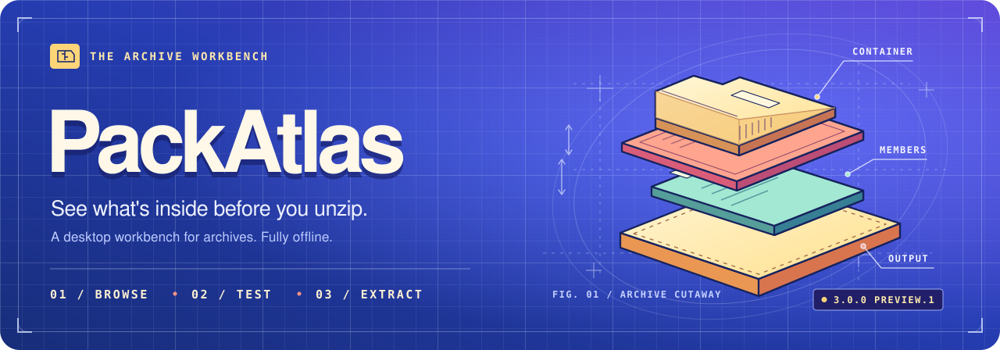
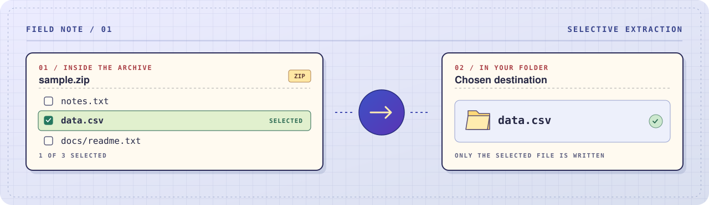

<p align="center">
  
</p>

<h1 align="center">PackAtlas · 展卷</h1>

<p align="center">
  <strong>先看清包里有什么，再解出你要的文件。</strong><br>
  Browse, test, and extract archives in an offline desktop workbench.
</p>

<p align="center">
  <a href="#上手体验"><strong>▶ 上手体验</strong></a> &nbsp;·&nbsp;
  <a href="#平台与安装"><strong>↓ 平台与安装</strong></a> &nbsp;·&nbsp;
  <a href="#从源码构建">从源码构建</a> &nbsp;·&nbsp;
  <a href="LICENSE">MIT</a>
</p>

<br>

## 一张桌面，三件事

收到一个很大的压缩包，却只需要里面的一个文件？展卷把**文件清单、完整性测试和解压设置**放在同一个工作台。拖进来，先看目录，再决定解哪几项、放到哪里。整个过程在本机完成。

|  | 你可以做什么 |
| --- | --- |
| **01 · 看清楚** | 把多个压缩包加入队列，浏览和搜索包内路径，直接勾选想解出的文件。 |
| **02 · 验一下** | 单独运行完整性测试，不写出文件。遇到受支持的加密包时，按提示输入密码。 |
| **03 · 解得有条理** | 选择智能布局、独立目录或就地解压。遇到同名文件可重命名或跳过，还能在历史记录里找回输出位置。 |

## 上手体验

<p align="center">
  
</p>

**整个包里只需要一份 CSV？** 在桌面版打开压缩包、勾选那一项，就能只解出它。上图是选择性解压示意。实际界面的纸面网格、墨线和压缩包手绘剖面借鉴了 [RackBook](https://github.com/CrianeZRX/rackbook) 的视觉语言，支持简体中文、繁體中文、English、日本語、한국어和 Español。

**不用安装也能看界面。** 把源码下载到本地，在浏览器中打开 [`Workbench/ui/index.html`](Workbench/ui/index.html)，点 **打开样例 / Open sample**，再点 **查看内容 / Browse contents**。网页只演示文件清单。要试解压，可以在桌面版打开 [样例 ZIP](Examples/体验包.zip)，勾选其中的 `数据.csv`。

## 平台与安装

当前版本为 **`3.0.0-preview.1`**。桌面版以 ZIP、RAR、7z 和常见 TAR 系列为主。macOS 另有 EGG、ALZ、ISZ、BH 等旧格式适配器，具体变体见 [兼容性说明](Docs/旧格式兼容性.md)。

| 平台 | 构建产物 | 当前状态 |
| --- | --- | --- |
| **macOS 13+ · Apple Silicon** | `.pkg` | 已有预览包，使用临时签名，未做 Apple 公证。可与轻解 2.3 并存。 |
| **Windows · x64** | 安装版与便携版 `.exe` | 已配置构建流程，待目标系统验证。 |
| **Ubuntu 24.04 · x64** | `.deb` / `.AppImage` | 已配置构建流程，待目标系统验证。 |

手头已有 `PackAtlas-3.0.0-preview.1-macOS-arm64.pkg` 的话，打开安装包即可尝试预览版。自行打包可用下面的命令，也可从 [构建工作流](.github/workflows/workbench.yml) 的成功运行中获取产物。

## 从源码构建

<details>
<summary><strong>macOS · 原生 ArchiveCore + WKWebView</strong></summary>

需要 Apple Silicon、Xcode Command Line Tools 和 Python 3。首次准备解码器时需要联网。

```bash
bash scripts/prepare-workbench-mac.sh
bash scripts/test.sh
bash scripts/build-workbench.sh
```

安装包输出到 `dist/Workbench/`。

</details>

<details>
<summary><strong>Windows / Ubuntu · Electron + 7-Zip</strong></summary>

参照 [构建工作流](.github/workflows/workbench.yml) 准备 7-Zip 26.06，并核对下载校验值。Windows 将 `7z.exe` 和 `7z.dll` 放入 `Workbench/engine/`，Ubuntu 放入 `7zz`。开发或测试时也可以将环境变量 `QUICKUNZIP_7ZIP` 设为解码器的绝对路径。

```bash
cd Workbench
npm install
npm test
npm start
```

打包时，在 Windows 上运行 `npm run package:win`，在 Ubuntu 上运行 `npm run package:linux`，产物在 `Workbench/dist/`。安装依赖需要联网，浏览、校验和解压可离线进行。

</details>

## 项目资料

- [工作台架构与路线](Docs/Workbench.md) · 共享界面、原生宿主与各平台解码路径
- [旧格式兼容性](Docs/旧格式兼容性.md) · EGG、ALZ、ISZ、BH 等格式的支持边界
- [轻解 2.3 文档](Docs/QuickUnzip-2.3.md) · 原版 macOS SwiftUI 应用与命令行
- [发布指引](Docs/Publish.md) · 构建产物与 GitHub 发布步骤

源代码采用 [MIT 许可](LICENSE)。组件和字体沿用各自的许可证，见 [第三方声明](THIRD_PARTY.md)。
